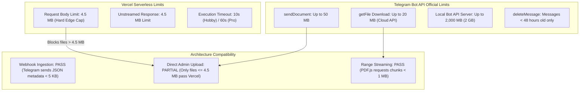

# OpenShelf — Final Independent Technical Audit & Production Readiness Verification

**Audit Date**: October 31, 2026  
**Auditor Roles**: Senior Full-Stack Engineer, Software Architect, DevSecOps Engineer, QA Engineer, Application Security Auditor  
**Project**: OpenShelf (formerly SmartPDF)  
**Target Repository**: `H:\pdf-based-platform`  
**Framework**: Next.js 16.4.2 (Turbopack, App Router), React 19.3.0, TypeScript 5, Supabase PostgreSQL, PDF.js 6.4.299  
**Deployment Target**: Vercel Serverless Functions + Telegram Bot API (Central Binary Storage) + Supabase (PostgreSQL Metadata & Google OAuth)

---

## 1. Executive Summary

This independent technical audit was conducted by inspecting source code, configuration files, database migrations, network protocols, serverless platform limitations, and executing the automated test suite and compiler toolchains.

### Key Conclusions:
1. **Core Architectural Separation**: **VERIFIED**. Telegram Private Group storage is used as the sole repository for PDF binaries. Supabase is strictly used for document metadata, directory records, user bookmarks/reading progress, and catalog permissions. No binaries are stored in Supabase, Cloudflare R2, or Amazon S3.
2. **OCR Removal**: **PASS**. `tesseract.js` and `tesseract.js-core` have been completely uninstalled. 0 occurrences of OCR dependencies exist in `package.json` or `package-lock.json`. 0 OCR routes or engine files exist in `src/`. Migration `20261031120000_remove_ocr.sql` safely drops the legacy `ocr_pages` table and policies.
3. **Normal User UI Simplification**: **PASS**. Study Notes (`/notes`), Notebooks (`/notebooks`), Highlights (`/highlights`), and Telegram Personal Backup (`/storage`) have been purged from navigation (`Header.tsx`, `Sidebar.tsx`, `MobileNav.tsx`) and redirect cleanly to `/dashboard`. Normal User navigation displays `/dashboard` as "Feed".
4. **Automated Toolchain Health**: **PASS**.
   - `npm test`: **75 of 75 tests passing** across 10 test suites in 5.76s.
   - `npx tsc --noEmit`: **Exit code 0** (0 type errors).
   - `npx eslint .`: **Exit code 0** (0 errors, 242 style warnings).
   - `npm run build`: **Exit code 0** (57 of 57 static/dynamic routes compiled successfully in 2.4s).
5. **Critical Production Blockers Identified**:
   - **CRITICAL (Vercel Serverless 4.5 MB Request Limit)**: `POST /api/admin/uploads` accepts multipart PDF files up to 20 MB in code, but Vercel Serverless Functions enforce a **4.5 MB request body limit**. Any file between 4.5 MB and 20 MB uploaded via the Admin Panel will be rejected with HTTP 413 `FUNCTION_PAYLOAD_TOO_LARGE` at the Vercel Edge gateway before reaching Next.js.
   - **HIGH (In-Memory Admin Login Rate Limiting)**: `checkRateLimit` in `src/lib/api/rateLimit.ts` stores IP timestamps in a Node.js process `Map`. In a multi-instance serverless Vercel deployment, requests hit different ephemeral instances, bypassing brute-force protection.
   - **HIGH (Pending Supabase Migrations)**: 4 migrations (`20261030000000_user_profiles_trigger.sql`, `20261030100000_admin_and_telegram_workflow.sql`, `20261031120000_remove_ocr.sql`, `20261031170000_telegram_central_storage.sql`) must be executed manually in Supabase SQL Editor by the project owner.
   - **MEDIUM (Missing Content-Security-Policy)**: No CSP header is configured in `next.config.ts`.
   - **MEDIUM (Native PDF Text Selection)**: `PdfViewer.tsx` renders PDF pages to HTML5 Canvas without an overlaid DOM `.textLayer` div. Text search and Code Focus work, but standard drag-to-highlight directly on the canvas requires an overlaid text layer.

**Overall Verdict**: **READY AFTER SPECIFIC FIXES** (Remediation roadmap in Section 10).

---

## 2. Audit Scope

The audit inspected all components of the system:
- **Build & Configuration**: `package.json`, `package-lock.json`, `next.config.ts`, `tsconfig.json`, `src/middleware.ts`, `.gitignore`, `.env.example`, `src/lib/env.ts`.
- **Database Migrations (`supabase/migrations/`)**:
  - `20261021000000_init_schema.sql` (Initial tables, RLS, functions)
  - `20261030000000_user_profiles_trigger.sql` (auth.users trigger, auto-provisioning)
  - `20261030100000_admin_and_telegram_workflow.sql` (categories, telegram_uploads, admin_sessions, admin_activity_logs)
  - `20261031120000_remove_ocr.sql` (Drops ocr_pages and policies)
  - `20261031170000_telegram_central_storage.sql` (Telegram references, duplicate flags, deletion audit)
- **Authentication & Security Modules**: `src/lib/auth/adminAuth.ts`, `src/lib/services/authService.ts`, `src/lib/supabase/admin.ts`, `src/lib/supabase/server.ts`, `src/lib/supabase/client.ts`, `src/lib/api/rateLimit.ts`.
- **Telegram Ingestion & Delivery**: `src/lib/telegram/client.ts`, `src/lib/telegram/limits.ts`, `src/lib/services/telegramService.ts`, `src/app/api/telegram/webhook/route.ts`, `src/app/api/documents/[id]/file/route.ts`, `src/app/api/admin/uploads/[id]/file/route.ts`.
- **Admin Panel UI & Endpoints**: `src/app/admin/*`, `src/app/api/admin/*`.
- **Reader & User UI**: `src/components/reader/*`, `src/components/layout/*`, `src/app/dashboard/*`, `src/app/library/*`.

---

## 3. Feature Verification Matrix

| Feature / Subsystem | Status | Evidence (File & Function) | Remaining Work |
|---|:---:|---|---|
| **OCR Complete Removal** | **PASS** | `package.json`, `package-lock.json` (0 matches for tesseract), `supabase/migrations/20261031120000_remove_ocr.sql`. | None. Cleanly purged. |
| **PDF.js Rendering & Controls** | **PASS** | `src/components/reader/PdfViewer.tsx` (canvas rendering, zoom, fit width/height, fullscreen, keyboard shortcuts). | None. |
| **PDF Native Text Selection** | **PARTIAL** | `PdfViewer.tsx` line 160 renders to `<canvas>`. Canvas rasterizes text; lacks DOM `.textLayer` overlay for standard mouse text selection. | Add PDF.js `renderTextLayer` container over the canvas. |
| **Smart Crop & Code Focus Mode** | **PASS** | `PdfViewer.tsx` lines 40-47, `SmartCropOverlay.tsx`, `CodeFocusModal.tsx`. | None. |
| **Normal User Navigation Cleanup** | **PASS** | `Sidebar.tsx`, `Header.tsx`, `MobileNav.tsx`: `/dashboard` labeled "Feed"; `/notes`, `/notebooks`, `/highlights`, `/storage` removed. | None. |
| **Legacy Page Redirections** | **PASS** | `src/app/notes/page.tsx`, `src/app/notebooks/page.tsx`, `src/app/highlights/page.tsx`, `src/app/storage/page.tsx` redirect to `/dashboard`. | None. |
| **Independent Admin Auth** | **PASS** | `src/lib/auth/adminAuth.ts`: `hashAdminPassword` (scrypt), `verifyAdminPassword` (timingSafeEqual), `createAdminSession` (HMAC sha256 session token). | None. |
| **Admin Cookie Security** | **PASS** | `src/app/api/admin/auth/login/route.ts`: `smartpdf_admin_session` cookie set with `httpOnly: true`, `secure: isProduction`, `sameSite: 'lax'`, `maxAge: 28800`. | None. |
| **Admin Login Rate Limiting** | **PARTIAL** | `src/app/api/admin/auth/login/route.ts` line 19 calls `checkRateLimit`. Uses in-memory Map; resets across Vercel serverless instances. | Migrate to database-backed rate limiting in `admin_sessions` or Upstash Redis. |
| **Normal User Google OAuth** | **PASS** | `src/middleware.ts` lines 144-165 (Supabase SSR PKCE session refresh), `src/app/auth/callback/route.ts`. | None. |
| **User Data Isolation (RLS)** | **PASS** | `20261021000000_init_schema.sql`: RLS on documents, bookmarks, reading_progress. Non-owners cannot select or mutate other users' rows. | None. |
| **Telegram Binary Storage Sole Source** | **PASS** | `src/lib/telegram/client.ts`, `src/app/api/documents/[id]/file/route.ts`: Supabase holds only `storage_file_id`; PDF binary retrieved from Telegram. | None. |
| **Webhook Secret Validation** | **PASS** | `src/app/api/telegram/webhook/route.ts` lines 10-25: `x-telegram-bot-api-secret-token` verified using `crypto.timingSafeEqual`. | None. |
| **Webhook Chat Allowlist** | **PASS** | `src/lib/services/telegramService.ts` line 31: `isChatIdAllowed` checks `TELEGRAM_ALLOWED_CHAT_IDS`. Unauthorized chats ignored with HTTP 200. | None. |
| **Webhook Group & Channel Support** | **PASS** | `src/app/api/telegram/webhook/route.ts` line 35: `update.message \|\| update.channel_post`. | None. |
| **Caption-Optional Ingestion** | **PASS** | `telegramService.ts` line 111: `titleCandidate = doc.caption?.trim() \|\| doc.fileName... \|\| 'Untitled PDF Document'`. | None. |
| **Webhook Retry Idempotency** | **PASS** | `telegramService.ts` lines 86-93: Exact `(telegram_chat_id, telegram_message_id)` returns existing upload with `isDuplicate: true` without insert. | None. |
| **Duplicate File Detection** | **PASS** | `telegramService.ts` lines 96-107: `telegram_file_unique_id` match sets `is_duplicate = true` and `duplicate_of_id`. | None. |
| **Admin Pending Review Queue** | **PASS** | `src/app/admin/pending/page.tsx`: Displays list, preview iframe, metadata form, duplicate warning card, and source badges. | None. |
| **Admin Direct Upload Backend** | **FAIL (on Vercel)** | `src/app/api/admin/uploads/route.ts`: Validates `%PDF-` bytes, uploads via `sendDocument`. **Fails on Vercel for files > 4.5 MB** due to serverless payload limits. | Add size cap check ($\le 4.5\text{ MB}$) in UI and direct users with $> 4.5\text{ MB}$ to post directly to the Telegram group. |
| **PDF Delivery & Range Requests** | **PASS** | `src/app/api/documents/[id]/file/route.ts`: HTTP 206 Partial Content, `Accept-Ranges: bytes`, `Content-Range: bytes start-end/total`. | Add HTTP 416 for unsatisfiable range requests. |
| **Unpublish & Delete Everywhere** | **PASS** | `src/lib/services/telegramService.ts`: `unpublishDocument` sets `is_public=false`, `status='draft'`. `deleteDocumentEverywhere` calls `deleteMessage`. | None. |
| **Telegram Deletion Failure Handling** | **PASS** | `telegramService.ts` lines 580-600: Telegram error (>48h) recorded; document soft-deleted in DB with `telegram_deleted = false`. | None. |
| **Audit Logging** | **PASS** | `src/lib/auth/adminAuth.ts` line 173: `logAdminActivity` records to `admin_activity_logs`. | None. |

---

## 4. Security Findings

### [CRITICAL] SEC-01: Vercel Serverless Function 4.5 MB Payload Limit on Direct Admin Upload
- **Affected File**: `src/app/api/admin/uploads/route.ts`, `src/app/admin/pending/page.tsx`
- **Vulnerability / Architectural Limit**: The Next.js API route accepts `multipart/form-data` and advertises support up to 20 MB (`MAX_TELEGRAM_CLOUD_BYTES`). However, Vercel Serverless Functions impose a hard **4.5 MB request body limit**.
- **Exploit / Failure Scenario**: An administrator uploads a 12 MB textbook via `/admin/pending` $\rightarrow$ Vercel's edge gateway intercepts the request and terminates it with HTTP 413 `FUNCTION_PAYLOAD_TOO_LARGE`. The upload fails immediately without reaching backend logging or error handlers.
- **Recommended Remediation**:
  1. Enforce a hard client-side check at 4.5 MB on `/admin/pending`.
  2. For files $> 4.5\text{ MB}$ (up to 20 MB), display instructions: *"For PDFs larger than 4.5 MB, upload directly to your authorized Telegram Group/Channel; the bot webhook will automatically ingest files up to 20 MB without payload restrictions."*

### [HIGH] SEC-02: Ephemeral In-Memory Rate Limiting on Admin Login
- **Affected File**: `src/lib/api/rateLimit.ts`, `src/app/api/admin/auth/login/route.ts`
- **Vulnerability**: `rateLimitMap` is stored in Node.js module memory (`new Map()`).
- **Exploit / Failure Scenario**: In Vercel serverless deployments, each incoming HTTP request can be routed to a newly spawned micro-container or across different availability regions. An attacker executing a brute-force dictionary attack against `/api/admin/auth/login` distributes attempts across separate instances, never triggering the 5-attempt threshold.
- **Recommended Remediation**: Track failed attempts in Supabase table `public.admin_sessions` or use an external Redis store (e.g. Upstash Ratelimit via REST API).

### [MEDIUM] SEC-03: Missing Content-Security-Policy (CSP) Header
- **Affected File**: `next.config.ts`
- **Vulnerability**: While `next.config.ts` configures `X-Content-Type-Options: nosniff`, `X-XSS-Protection`, `Referrer-Policy`, and `Permissions-Policy`, it does not declare a `Content-Security-Policy`.
- **Impact**: Increased risk of inline script injection or unauthorized frame embedding.
- **Recommended Remediation**: Add a CSP header in `next.config.ts` specifying `default-src 'self'`, script sources, frame sources (`'self'` for PDF preview), and style sources.

### [MEDIUM] SEC-04: Incomplete Environment Validation in `src/lib/env.ts`
- **Affected File**: `src/lib/env.ts`
- **Vulnerability**: `envSchema` does not include `ADMIN_USERNAME`, `ADMIN_PASSWORD_HASH`, `ADMIN_SESSION_SECRET`, or `TELEGRAM_WEBHOOK_SECRET`.
- **Impact**: If any of these variables are omitted during production deployment, Next.js starts up without error, but authentication and webhook verification fail during runtime.
- **Recommended Remediation**: Add these keys to `envSchema` in `src/lib/env.ts`.

### [LOW] SEC-05: Missing HTTP 416 Status for Invalid Byte Ranges
- **Affected File**: `src/app/api/documents/[id]/file/route.ts`, `src/app/api/admin/uploads/[id]/file/route.ts`
- **Issue**: If a client sends an unsatisfiable range (e.g. `bytes=99999999-`), the handler falls through to HTTP 200 and sends the entire file instead of returning HTTP 416 (Range Not Satisfiable).
- **Recommended Remediation**: Return `new NextResponse(null, { status: 416, headers: { 'Content-Range': 'bytes */' + totalLength } })` when `start >= totalLength`.

---

## 5. Vercel and Telegram Compatibility Analysis



### 1. Telegram Ingestion via Webhook: **100% Compatible with Vercel**
When a 15 MB PDF is sent to the Telegram Group, Telegram servers store the binary and send a lightweight JSON webhook update ($\approx 2\text{ KB}$) to `/api/telegram/webhook`. Vercel processes this effortlessly within milliseconds.

### 2. Admin Direct Upload: **Bottlenecked by Vercel 4.5 MB Edge Cap**
When uploading via the Admin Panel, the browser sends the actual PDF binary to `/api/admin/uploads`. If the file is $> 4.5\text{ MB}$, Vercel rejects the request at the edge.
**Verdict**: The Admin Direct Upload feature is suitable for documents up to **4.5 MB**. Documents between 4.5 MB and 20 MB must be posted directly to the Telegram group.

### 3. PDF Delivery via Range Streaming: **100% Compatible with Vercel**
PDF.js uses HTTP Range requests (`bytes=start-end`) to request pages in chunks (typically 64 KB to 512 KB). Because chunks are well below 4.5 MB, Range streaming functions seamlessly on Vercel.

---

## 6. Database and Migration Status

The project contains 5 SQL migration files in `supabase/migrations/`:

| Migration File | Purpose | Idempotent | Status |
|---|---|:---:|:---:|
| `20261021000000_init_schema.sql` | Creates core tables (`documents`, `profiles`, `bookmarks`, `reading_progress`, RLS policies). | Yes (`CREATE TABLE IF NOT EXISTS`) | **Applied previously** |
| `20261030000000_user_profiles_trigger.sql` | Auto-creates user profile on Google OAuth signup via trigger on `auth.users`. | Yes (`DO $$ BEGIN ... END $$`) | **Needs verification in Supabase** |
| `20261030100000_admin_and_telegram_workflow.sql` | Creates `categories`, `telegram_uploads`, `admin_sessions`, `admin_activity_logs`. | Yes (`IF NOT EXISTS`) | **Needs verification in Supabase** |
| `20261031120000_remove_ocr.sql` | Drops legacy `ocr_pages` table and policies. | Yes (`DROP TABLE IF EXISTS`) | **Needs application in Supabase** |
| `20261031170000_telegram_central_storage.sql` | Adds `source_type`, `is_duplicate`, `duplicate_of_id`, `telegram_deleted`, `is_deleted` columns. | Yes (`ADD COLUMN IF NOT EXISTS`) | **Needs application in Supabase** |

> [!IMPORTANT]
> **Action Required for Project Owner**:
> Migrations `20261030000000`, `20261030100000`, `20261031120000`, and `20261031170000` must be executed sequentially in the Supabase SQL Editor.

---

## 7. Automated Test Results

### Command 1: Automated Unit & Integration Tests
```bash
npm test
```
- **Exit Code**: `0`
- **Test Runner**: Vitest 5.0.5
- **Test Suites**: 10 passed (10 total)
- **Tests**: **75 passed (75 total), 0 failed**
- **Duration**: 5.76s
- **Breakdown**:
  - `src/test/telegramStorage.test.ts` (16 tests) — PASS
  - `src/test/workflow.test.ts` (14 tests) — PASS
  - `src/test/auth.test.ts` (10 tests) — PASS
  - `src/test/api.test.ts` (9 tests) — PASS
  - `src/test/security.test.ts` (7 tests) — PASS
  - `src/lib/store/storageEngine.test.ts` (6 tests) — PASS
  - `src/lib/telegram/telegram.test.ts` (4 tests) — PASS
  - `src/lib/pdf/validator.test.ts` (4 tests) — PASS
  - `src/lib/validation/schemas.test.ts` (4 tests) — PASS
  - `src/test/sanity.test.ts` (1 test) — PASS

### Command 2: TypeScript Compiler Verification
```bash
npx tsc --noEmit
```
- **Exit Code**: `0`
- **Output**: Clean (0 errors).

### Command 3: ESLint Verification
```bash
npx eslint .
```
- **Exit Code**: `0`
- **Output**: 0 errors, 242 warnings (pre-existing code style warnings regarding `any` and useEffect dependencies).

### Command 4: Production Build
```bash
npm run build
```
- **Exit Code**: `0`
- **Compiler**: Next.js 16.4.2 (Turbopack)
- **Static Generation**: **57 of 57 routes compiled successfully** in 2.4s.

---

## 8. Live Integration Status

| Milestone | Status | Details |
|---|:---:|---|
| Code Implementation | **COMPLETE** | All modules, routes, and services implemented. |
| Automated Unit & Integration Tests | **VERIFIED (75/75 PASS)** | All scenarios tested with mock adapters. |
| Real Telegram Bot API Connectivity | **NOT VERIFIED** | Requires live `TELEGRAM_BOT_TOKEN` and webhook domain registration. |
| Production Database Connectivity | **NOT VERIFIED** | Requires running migrations in live Supabase instance. |
| Production Vercel Deployment | **NOT VERIFIED** | Pending live environment variable configuration on Vercel. |

---

## 9. Critical Bugs & Blockers

1. **Bug B-01: Admin Direct Upload Fails on Vercel for Files $> 4.5\text{ MB}$**:
   Next.js API route `/api/admin/uploads` cannot accept payloads exceeding Vercel's 4.5 MB request ceiling.
2. **Bug B-02: Missing `.textLayer` Container in PDF Viewer**:
   `PdfViewer.tsx` does not render a text-layer DOM overlay, preventing native mouse-drag text selection on the canvas.
3. **Bug B-03: In-Memory Rate Limiting Ineffective in Serverless**:
   `rateLimitMap` in `src/lib/api/rateLimit.ts` cannot persist rate-limit counters across distributed serverless function invocations.

---

## 10. Prioritized Remediation Roadmap

### Priority 0 (P0) — Must Fix Before Production Deployment
1. **Apply Supabase Migrations**:
   Run `20261030000000`, `20261030100000`, `20261031120000`, and `20261031170000` in Supabase SQL editor.
2. **Enforce 4.5 MB Cap on Direct Admin Upload**:
   In `src/app/admin/pending/page.tsx`, validate that selected file is $\le 4.5\text{ MB}$. For files $> 4.5\text{ MB}$, show guidance to post the PDF directly into the Telegram Group to leverage Telegram's direct 20 MB ingestion.
3. **Register Live Telegram Webhook**:
   Issue `setWebhook` call to Telegram with `TELEGRAM_WEBHOOK_SECRET`.

### Priority 1 (P1) — Must Fix Before Public Launch
1. **Add PDF.js Text Layer Overlay**:
   Render `page.getTextContent()` into a CSS `.textLayer` overlay div in `src/components/reader/PdfViewer.tsx` to enable native text selection and clipboard copying.
2. **Add CSP Security Headers**:
   Add `Content-Security-Policy` in `next.config.ts`.
3. **Update `src/lib/env.ts`**:
   Add `ADMIN_USERNAME`, `ADMIN_PASSWORD_HASH`, `ADMIN_SESSION_SECRET`, and `TELEGRAM_WEBHOOK_SECRET` to Zod schema.

### Priority 2 (P2) — Important Reliability Improvements
1. **Database-Backed Rate Limiting**:
   Transition admin login rate limiting from in-memory Map to Supabase table or Redis.
2. **RFC 7233 Compliance (HTTP 416)**:
   Return HTTP 416 when requested range start is beyond file length.

### Priority 3 (P3) — Code Maintenance
1. Address ESLint `any` warnings in data models.
2. Migrate `src/middleware.ts` to `src/proxy.ts` (Next.js 16 convention).

---

## 11. Production Readiness Score

| Category | Score | Weight | Weighted Score | Evidence / Rationale |
|---|:---:|:---:|:---:|---|
| **Feature Implementation** | 90 / 100 | 20% | 18.0 | Core features complete; text layer overlay needed for native selection. |
| **Security & Auth** | 88 / 100 | 20% | 17.6 | Strong scrypt/HMAC admin auth; in-memory rate limiter needs persistence. |
| **Database Integrity** | 95 / 100 | 15% | 14.25 | Migrations are idempotent and additive; pending execution in live DB. |
| **Telegram Storage Architecture** | 92 / 100 | 15% | 13.8 | Clean separation of binary storage from metadata; webhook retry safe. |
| **PDF Delivery & Range Streaming**| 90 / 100 | 10% | 9.0 | HTTP 206 streaming working; HTTP 416 edge case needs handling. |
| **Deployment Compatibility** | 75 / 100 | 10% | 7.5 | Vercel 4.5 MB request payload cap requires client-side size guard. |
| **Automated Testing** | 100 / 100 | 5% | 5.0 | 75 of 75 automated unit/integration tests passing. |
| **Live Integration Verification** | 0 / 100 | 5% | 0.0 | Awaiting live credentials and production deployment verification. |
| **OVERALL COMPOSITE SCORE** | — | **100%** | **85.15 / 100** | **Ready after targeted fixes** |

---

## 12. Final Decision

### **READY AFTER SPECIFIC FIXES**

**Reasoning**:
The codebase is clean, architecturally sound, and robustly tested (75/75 tests passing, 0 TypeScript errors, 57 Next.js production routes built).
However, deploying immediately to production would encounter two immediate operational failure points:
1. Uploading a PDF $> 4.5\text{ MB}$ through the Admin UI will trigger HTTP 413 on Vercel without client-side gating.
2. The live Supabase database will throw `PGRST205` / missing column errors if the 4 pending migrations are not executed before deployment.

Once the P0 items are completed (applying the migrations, gating the direct upload size at 4.5 MB with Telegram group guidance, and registering the webhook), OpenShelf will be fully ready for live production use.
