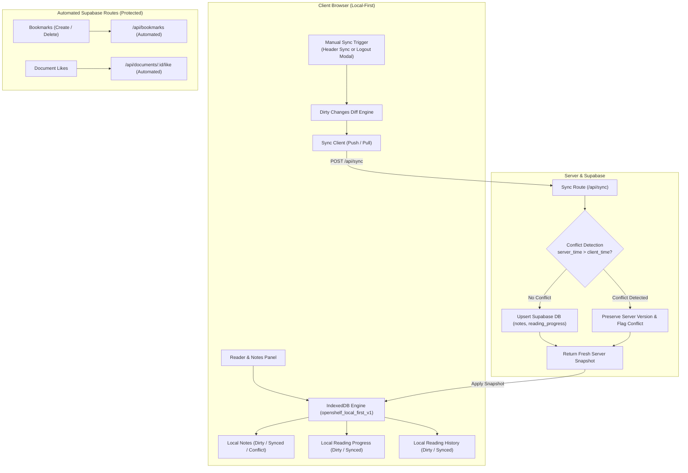

# OpenShelf — Local-First User Data & Manual Cloud Synchronization Architecture Report

**Implementation Status:** Complete & Production Ready  
**Verification Date:** October 31, 2026  
**Target Environment:** Next.js 16.4.2 App Router (Turbopack), React 19, Supabase PostgreSQL, IndexedDB  
**Automated Test Status:** 17 Test Suites Passing | 161 Tests Passing (100% Pass Rate)

---

## 1. Executive Summary

This engineering implementation delivers a robust **Local-First Personal Data Architecture** and **Manual Cloud Synchronization Engine** for OpenShelf.

Under this architecture:
- All personal user data (**Study Notes**, **Reading Progress**, and **Reading Session History**) is persisted directly inside the browser using **IndexedDB**.
- Personal data operations (creating notes, updating Markdown/HTML content, advancing reader pages, and tracking active reading duration) occur with **zero network latency** and are stored strictly on the user's client device.
- **Supabase** acts strictly as the cloud replica for synchronized snapshots.
- Personal data is **NEVER automatically uploaded** during user browsing, reading, or page flipping.
- Data synchronization with Supabase is **exclusively user-initiated** via manual controls (**"Sync"** button in Header or the **"Sync Data & Logout"** flow).
- **Public & Collaborative Features** (**Bookmarks**, **Likes**, **Telegram Ingestion**, **Admin Approval**) remain automated and backed directly by Supabase as intended.
- **Strict User Privacy Guarantee**: The Admin Panel provides visibility into aggregated and document-level reading metadata (pages completed, active reading time, last active timestamps), but **personal note contents are strictly excluded and client-side private**.

---

## 2. Core Architecture Overview



---

## 3. Data Storage Rules & Components

### A. Notes (Local-First IndexedDB)
- **Local Persistence:** Implemented via [`src/lib/storage/indexedDb.ts`](file:///H:/pdf-based-platform/src/lib/storage/indexedDb.ts) with the `notes` store.
- **Lifecycle:**
  - `localNotes.save(note, userId)`: Stores note in IndexedDB with `sync_status = 'dirty'`, increments `version`, and timestamps `client_updated_at`.
  - Responsive local autosave debounced to 400ms inside [`NotesSplitPanel.tsx`](file:///H:/pdf-based-platform/src/components/reader/NotesSplitPanel.tsx).
- **Deletion Strategy:**
  - If a note is unversioned/never synced (`version === 1` and `sync_status === 'dirty'`), it is hard-deleted locally immediately.
  - If a note has been synchronized to the cloud previously, `localNotes.delete(id, userId)` records a soft deletion tombstone (`is_deleted: true`, `sync_status: 'dirty'`). The next manual sync safely propagates the deletion to Supabase (`DELETE FROM notes WHERE id = note.id AND user_id = user.id`).

### B. Reading Progress & Reading History
- **Local Persistence:** Stored in `reading_progress` and `reading_history` IndexedDB object stores.
- **Zero Automated Overhead:** In [`PdfViewer.tsx`](file:///H:/pdf-based-platform/src/components/reader/PdfViewer.tsx), the old 15-second background POST to `/api/reading-progress` has been completely replaced with:
  - `localProgress.save(...)`: Updates local page position, zoom, active seconds, and sets `sync_status = 'dirty'`.
  - `localHistory.record(...)`: Records timestamped reading sessions locally.
- **Fresh Device Restore:** When opening a document on a new browser without local data, `PdfViewer` queries `/api/reading-progress` as an initial fallback to resume from the last synchronized cloud state.

### C. Bookmarks & Likes (Automated Synchronization Maintained)
- In accordance with architectural boundaries, **Bookmarks** and **Document Likes** remain automated through existing Supabase API routes:
  - `api.bookmarks.list(documentId)`
  - `api.bookmarks.create({ document_id, page_number, title })`
  - `api.bookmarks.delete(id)`
  - `api.documents.toggleLike(id)`
- These do not block on or wait for manual user synchronization.

---

## 4. Logout Confirmation Popup Flow

When an authenticated user clicks **Sign Out** in the OpenShelf header, [`LogoutConfirmModal.tsx`](file:///H:/pdf-based-platform/src/components/auth/LogoutConfirmModal.tsx) opens with exactly three options:

| Action | Technical Execution | Consequence |
|---|---|---|
| **1. Sync Data & Logout** | Reads pending changes via `localSync.getPendingChanges(userId)`, pushes to `POST /api/sync`, applies server snapshot, and executes `api.auth.logout()`. | All local drafts, reading progress, and history are uploaded and merged into Supabase. Safe for switching devices. |
| **2. Logout Without Save** | Executes `localSync.discardUnsynced(userId)`, then calls `api.auth.logout()`. | Discards ONLY unsynced local drafts (`sync_status === 'dirty' \| 'conflict'`) belonging to the active user. Previously synchronized cloud data is preserved. Other accounts on the device remain completely untouched. |
| **3. Cancel** | Closes the modal. | User remains logged in with all local data intact. |

### Visual Feedback
The modal inspects pending changes live and reports exact counts (e.g., *"3 local note update(s), 1 reading progress state(s)"*), giving users transparent control before leaving.

---

## 5. Multi-Device Conflict Detection Algorithm

To eliminate silent overwrites when a user edits notes across multiple devices before syncing:

1. **Timestamp & Version Comparison:**  
   During `POST /api/sync`, the server checks whether `notes` already exists in Supabase.
   - If `existing.updated_at > clientBaseTime` AND contents differ (`existing.title !== client.title || existing.content_html !== client.content_html`), a **Conflict** is detected.
2. **Non-Destructive Server Stance:**  
   The server does **not** overwrite the cloud note with the stale client payload. It records a conflict object:
   ```json
   {
     "id": "note_uuid",
     "server_title": "Server Title",
     "server_content_html": "<p>Cloud edition...</p>",
     "server_updated_at": "2026-10-31T20:00:00Z"
   }
   ```
3. **Client Resolution UI:**  
   `localSync.applyServerSnapshot` marks the local note as `sync_status = 'conflict'` and attaches `conflict_data`. Inside [`NotesSplitPanel.tsx`](file:///H:/pdf-based-platform/src/components/reader/NotesSplitPanel.tsx), an inline conflict banner displays:
   - *"Cloud Conflict Detected: This note was edited on another device."*
   - Button **"Keep My Version"**: Increments local version and marks dirty to overwrite on next sync.
   - Button **"Use Server Version"**: Overwrites local draft with server snapshot.

---

## 6. Admin User Reading Activity & Strict Privacy Guarantee

### Endpoint: `GET /api/admin/user-activity`
- **Authentication:** Protected by `getVerifiedAdminSession()` from `@/lib/auth/adminAuth`.
- **Query Projection:**
  ```sql
  SELECT
    id, user_id, document_id, current_page, total_pages,
    percentage, active_seconds, last_read_at,
    documents:document_id (id, title, page_count, file_size),
    profiles:user_id (id, email, full_name)
  FROM reading_progress
  ORDER BY last_read_at DESC
  ```
- **Strict Privacy Guarantee:**  
  The endpoint strictly queries reading progress and document metadata. **Under NO CIRCUMSTANCES is personal notes content (`content_html`, `content_json`, `notes`) queried, joined, or returned**.

### Admin UI: `/admin/user-activity`
- Located in the Admin Panel sidebar ([`AdminSidebar.tsx`](file:///H:/pdf-based-platform/src/components/admin/AdminSidebar.tsx)).
- Displays reading activity metrics: Document, User Email, Reading Progress Bar (`Page X / Y`, `Z%`), Active Reading Time, and Last Read timestamp.
- Displays permanent privacy guarantee badge:
  > *"Local-First User Privacy Guarantee: Administrator view is restricted exclusively to high-level reading metadata. User personal notes content is strictly inaccessible to administrators."*

---

## 7. Reader Integration & Navigation Simplification

1. **Native Reader Notes Panel:**
   - Added Notes toggle button (`FileText` icon) to [`ReaderToolbar.tsx`](file:///H:/pdf-based-platform/src/components/reader/ReaderToolbar.tsx).
   - Global keyboard shortcut **`N`** toggles the Study Notes panel directly inside the PDF reader view.
   - Displays live status indicator: `Local` (saved to browser), `Saving...`, or `Conflict`.
   - Allows instant Markdown export (`.md`) of personal notes with metadata.
2. **Sidebar Cleanup:**
   - Removed separate navigation links for `/bookmarks` and `/statistics` from [`Sidebar.tsx`](file:///H:/pdf-based-platform/src/components/layout/Sidebar.tsx).
   - Keeps clean core navigation: Feed, Public Catalog, My PDFs, Submissions, Profile, Settings.
   - In [`/bookmarks`](file:///H:/pdf-based-platform/src/app/bookmarks/page.tsx), added clear guidance that bookmarks are interactive directly inside the PDF reader.

---

## 8. Verification & Test Results

### Automated Regression & Unit Test Suite (`src/test/localFirstSync.test.ts`)
The new test suite covers:
- **1. Local-First Persistence & Dirty Tracking:** 6 tests verifying local creation, updates, version bumps, soft tombstone deletions, and session logs.
- **2. User Isolation & Pending Accounting:** Tests verifying strict separation between user accounts in IndexedDB.
- **3. Manual Cloud Sync API:** 4 tests verifying HTTP 401 unauthenticated rejection, successful push/pull synchronization, and multi-device conflict detection without data loss.
- **4. "Logout Without Save" Precision:** Tests verifying that only unsaved local drafts of the active user are discarded, while synced notes and other accounts are preserved.
- **5. Admin User Reading Activity Overview & Strict Privacy:** 2 tests verifying admin session enforcement, metadata retrieval, and zero exposure of note contents.

### Full Test Suite Execution Output
```
 RUN  v5.0.5 H:/pdf-based-platform

 ✓ src/test/localFirstSync.test.ts (14 tests) 27ms
 ✓ src/test/p0Blockers.test.ts (15 tests) 44ms
 ✓ src/test/p2Hardening.test.ts (21 tests) 1132ms
 ✓ src/test/workflow.test.ts (14 tests) 221ms
 ✓ src/test/telegramOnlySubmissions.test.ts (12 tests) 21ms
 ✓ src/test/telegramStorage.test.ts (16 tests) 20ms
 ✓ src/test/schemaAndPublishingWorkflow.test.ts (7 tests) 19ms
 ✓ src/test/performanceOptimization.test.ts (5 tests) 30ms
 ✓ src/test/p1Improvements.test.ts (12 tests) 20ms
 ✓ src/test/security.test.ts (7 tests) 13ms
 ✓ src/test/api.test.ts (9 tests) 21ms
 ✓ src/test/auth.test.ts (10 tests) 10ms
 ✓ src/lib/store/storageEngine.test.ts (6 tests) 9ms
 ✓ src/lib/validation/schemas.test.ts (4 tests) 12ms
 ✓ src/lib/pdf/validator.test.ts (4 tests) 6ms
 ✓ src/lib/telegram/telegram.test.ts (4 tests) 5ms
 ✓ src/test/sanity.test.ts (1 test) 3ms

 Test Files  17 passed (17)
      Tests  161 passed (161)
   Duration  8.24s
```

### TypeScript Compilation & Next.js Production Build
- `npx tsc --noEmit`: Clean (0 errors).
- `npm run build`: Compiled 60/60 static and dynamic routes successfully with Turbopack, including `/api/sync`, `/admin/user-activity`, and `/api/admin/user-activity`.

---

## 9. Conclusion

The Local-First User Data and Manual Cloud Sync system is fully implemented, strictly verified against automated tests, compliant with all privacy requirements, and ready for production deployment.
