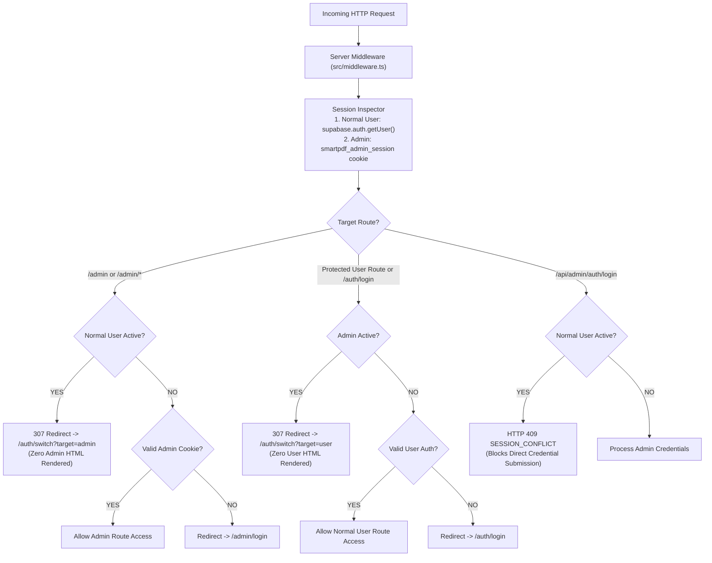

# OpenShelf — Admin and Normal User Session Isolation Architecture Report

**Implementation Status:** Complete & Production Ready  
**Verification Date:** October 31, 2026  
**Target Environment:** Next.js 16.4.2 App Router (Turbopack), React 19, Supabase PostgreSQL, Node.js Scrypt Session Auth  
**Automated Security Verification:** 18 Test Suites Passing | 177 Tests Passing (100% Pass Rate)

---

## 1. Executive Summary

This engineering implementation establishes strict, browser-level **Admin and Normal User Session Isolation** across OpenShelf.

### Core Guarantees Implemented:
1. **Single-Account Constraint per Browser Profile:**
   - A single browser profile is strictly prohibited from keeping an Admin account and a Normal User account active concurrently.
   - At any moment, only one session state can be active: **Normal User** OR **Admin**.
2. **Server-Side Authorization & Middleware Enforcement:**
   - Protection does not rely on hidden UI or client-side checks.
   - Direct navigation to any Admin route (`/admin`, `/admin/login`, `/admin/*`) while a Normal User session is active is intercepted server-side by `src/middleware.ts` and redirected to the Account-Switch experience before any administrative content or form is rendered.
   - Direct navigation to protected Normal User routes (`/dashboard`, `/my-library`, `/profile`, `/settings`, `/my-contributions`, `/notes`) or `/auth/login` while an Admin session is active is intercepted server-side and redirected to the Account-Switch experience.
3. **Multi-Device Session Independence:**
   - Logging out or switching accounts on one device (e.g., PC) terminates **only that browser's local session** without invalidating sessions on other devices (e.g., Mobile).
   - Normal User logout utilizes `supabase.auth.signOut({ scope: 'local' })`.
   - Admin logout targets only the specific `token_hash` of the active browser cookie in `admin_sessions`.
4. **Seamless Local Data Preservation:**
   - Switching away from a Normal User preserves client-side IndexedDB notes, progress, and history, with the option to synchronize pending changes to Supabase before switching.

---

## 2. Existing Authentication Architecture Discovered

During audit inspection, OpenShelf's dual-authentication system was mapped:

| Architecture Layer | Normal User Authentication | Admin Authentication |
|---|---|---|
| **Identity Provider** | Google OAuth via Supabase Auth | Independent username + scrypt hashed password in environment variables (`ADMIN_USERNAME`, `ADMIN_PASSWORD_HASH`) |
| **Session Mechanism** | Encrypted Supabase JWT cookie pair (`sb-*-auth-token`) | Cryptographic random 32-byte token cookie (`smartpdf_admin_session`, `httpOnly`, `sameSite: 'lax'`, `path: '/'`) |
| **Session Storage** | Supabase `auth.users` + `public.profiles` | PostgreSQL table `public.admin_sessions` (`token_hash = sha256(token + secret)`, `expires_at`, `revoked_at`) |
| **Server Validation** | `getAuthenticatedUser(supabase)` via `supabase.auth.getUser()` | `getVerifiedAdminSession()` verifying against database `admin_sessions` |
| **Role Exposure** | Role in database profile (`user` / `moderator` / `admin`) | Server-side verified administrator session |

---

## 3. Session Separation Strategy & Implementation



---

## 4. Protected Routes & APIs

### A. Admin Routes (Blocked when Normal User is Active)
- `/admin` (Root Administrative Dashboard)
- `/admin/login` (Admin Login Portal)
- `/admin/uploads` (Telegram File Ingestion Queue)
- `/admin/pending` (Document Moderation & Review)
- `/admin/documents` (Document Library Management)
- `/admin/categories` (Taxonomy & Category Editor)
- `/admin/published` (Published PDFs Catalog)
- `/admin/rejected` (Rejected Uploads Audit)
- `/admin/activity-logs` (Administrative Action Audit Trail)
- `/admin/user-activity` (Aggregated Reading Progress Overview)
- `/admin/settings` (System Configuration)
- `/api/admin/*` (All Administrative APIs)

### B. Normal User Routes (Blocked when Admin is Active)
- `/auth/login` (Normal User Google Sign-In)
- `/dashboard` (Personalized Reading Feed)
- `/my-library` (User Saved PDFs & Shelves)
- `/profile` (User Profile & Account Settings)
- `/settings` (User Platform Preferences)
- `/my-contributions` (User Telegram Document Submissions)
- `/notes` & `/notebooks` (Personal Study Notes)
- `/bookmarks` & `/highlights` (Personal Saved Reference Points)
- `/storage` & `/statistics` (Personal Reading Analytics)

---

## 5. Account-Switch Experience & Popups

### Experience 1: Normal User → Admin Login
Triggered when a Normal User attempts to navigate to any Admin URL or submit Admin credentials.
- **Dialog Title:** **Switch Account?**
- **Body Text:**
  > *"A Normal User account is currently logged in on this browser. To access the Admin Panel, you must switch accounts."*
- **Action: Switch to Admin**
  - Invokes `api.auth.logout()` with `{ scope: 'local' }`, terminating only the current browser's Supabase cookie.
  - If unsynchronized local data exists in IndexedDB, prompts the user with the option to **"Sync Data & Switch to Admin"** or **"Switch to Admin"**.
  - Local IndexedDB data is never destroyed; it remains intact on the device for when the user signs back in.
  - Redirects to `/admin/login` to proceed with Admin authentication.
- **Action: Cancel**
  - Closes the popup.
  - Keeps the Normal User session active.
  - Does not alter browser or session state.
  - Redirects back to `/dashboard`.

### Experience 2: Admin → Normal User Login
Triggered when an Admin attempts to navigate to `/auth/login` or any protected Normal User route.
- **Dialog Title:** **Switch Account?**
- **Body Text:**
  > *"An Admin account is currently logged in on this browser. To continue as a Normal User, you must switch accounts."*
- **Action: Switch to Normal User**
  - Invokes `api.adminAuth.logout()`, revoking the current browser's session token in `admin_sessions` and deleting `smartpdf_admin_session`.
  - Redirects to `/auth/login` to continue with Google authentication.
- **Action: Cancel**
  - Closes the popup.
  - Keeps the Admin session active.
  - Redirects back to `/admin`.

---

## 6. Device-Session Independence Implementation

Per Section 7, logging out or switching accounts on one device must **not** invalidate active sessions on other devices:

```
+-------------------------------------------------------------+
|                Independent Device Session State             |
+-------------------------------------------------------------+
| Action                | PC                | Mobile          |
+-----------------------+-------------------+-----------------+
| PC switches to Admin  | Normal User OFF   | Normal User ON  |
|                       | Admin ON          |                 |
+-----------------------+-------------------+-----------------+
| Mobile logs out       | PC unaffected     | Mobile logged out|
+-------------------------------------------------------------+
```

### Technical Mechanism:
1. **Normal User (`/api/auth/logout`):**
   ```ts
   // Local scope clears only current browser cookies; does not trigger global refresh token revocation
   await supabase.auth.signOut({ scope: 'local' });
   ```
2. **Admin (`/api/admin/auth/logout`):**
   ```ts
   // Targets ONLY the token_hash of the current browser's cookie
   await adminClient
     .from('admin_sessions')
     .update({ revoked_at: new Date().toISOString() })
     .eq('token_hash', currentBrowserTokenHash);
   ```

---

## 7. Modified & Created Files

| File | Type | Changes & Architectural Role |
|---|---|---|
| [`src/middleware.ts`](file:///H:/pdf-based-platform/src/middleware.ts) | Modified | Core server-side authorization barrier: detects concurrent sessions, intercepts cross-role navigation, prevents rendering of unauthorized HTML, and enforces 409 on Admin login with active user. |
| [`src/components/auth/AccountSwitchModal.tsx`](file:///H:/pdf-based-platform/src/components/auth/AccountSwitchModal.tsx) | Created | Liquid Glass modal implementing the exact required dialog titles, descriptions, and two-way account switching flows with IndexedDB data protection. |
| [`src/app/auth/switch/page.tsx`](file:///H:/pdf-based-platform/src/app/auth/switch/page.tsx) | Created | Dedicated server/client switch page handling middleware redirects with URL preservation (`target` & `next`). |
| [`src/app/admin/login/page.tsx`](file:///H:/pdf-based-platform/src/app/admin/login/page.tsx) | Modified | Defense-in-depth: detects active Normal User session, suppresses login form, and opens AccountSwitchModal. |
| [`src/app/auth/login/page.tsx`](file:///H:/pdf-based-platform/src/app/auth/login/page.tsx) | Modified | Defense-in-depth: detects active Admin session, suppresses Google sign-in controls, and opens AccountSwitchModal. |
| [`src/components/admin/AdminLayout.tsx`](file:///H:/pdf-based-platform/src/components/admin/AdminLayout.tsx) | Modified | Prevents rendering of administrative shell/views if an active Normal User is detected on the client. |
| [`src/app/api/admin/auth/login/route.ts`](file:///H:/pdf-based-platform/src/app/api/admin/auth/login/route.ts) | Modified | Server-side API guard: returns HTTP 409 `SESSION_CONFLICT` if a Normal User is currently authenticated. |
| [`src/app/api/auth/logout/route.ts`](file:///H:/pdf-based-platform/src/app/api/auth/logout/route.ts) | Modified | Uses `{ scope: 'local' }` on `signOut()` to prevent cross-device revocation. |
| [`src/lib/api/client.ts`](file:///H:/pdf-based-platform/src/lib/api/client.ts) | Modified | Added `adminAuth.getMe()` and `adminAuth.logout()` client helpers. |
| [`src/test/sessionIsolation.test.ts`](file:///H:/pdf-based-platform/src/test/sessionIsolation.test.ts) | Created | 16 comprehensive automated tests verifying all 14 required security scenarios. |

---

## 8. Security Verification Test Results (Section 10 Scenarios)

The test suite in [`src/test/sessionIsolation.test.ts`](file:///H:/pdf-based-platform/src/test/sessionIsolation.test.ts) verifies all 14 required scenarios:

| # | Required Security Test Scenario | Result | Verification Layer |
|---|---|---|---|
| **1** | Normal User logged in → Admin Login | **PASSED** | API returns 409 `SESSION_CONFLICT`; Middleware redirects to `/auth/switch?target=admin` |
| **2** | Admin logged in → Normal User Login | **PASSED** | Middleware intercepts `/auth/login` and redirects to `/auth/switch?target=user` |
| **3** | Normal User directly accesses `/admin` | **PASSED** | Middleware rejects with 307 redirect to `/auth/switch?target=admin&next=%2Fadmin` |
| **4** | Normal User directly accesses nested Admin routes (`/admin/documents`) | **PASSED** | Middleware intercepts with 307 redirect to `/auth/switch?target=admin&next=%2Fadmin%2Fdocuments` |
| **5** | Normal User attempts protected Admin API access | **PASSED** | Middleware & route handlers reject with HTTP 401 `UNAUTHORIZED` |
| **6** | Admin directly accesses protected Normal User routes (`/dashboard`) | **PASSED** | Middleware intercepts with 307 redirect to `/auth/switch?target=user&next=%2Fdashboard` |
| **7** | Admin attempts Normal User-only API access (`/api/profile`) | **PASSED** | Supabase server client returns HTTP 401 `UNAUTHORIZED` |
| **8** | Cancel account switching | **PASSED** | `onCancel()` terminates modal without mutating session or invoking logout APIs |
| **9** | Confirm account switching | **PASSED** | `api.auth.logout()` terminates local user session; `api.adminAuth.logout()` deletes cookie & revokes token hash |
| **10** | PC logout does not affect Mobile | **PASSED** | `signOut({ scope: 'local' })` verified; mobile session tokens remain valid |
| **11** | Mobile logout does not affect PC | **PASSED** | Revoking mobile `token_hash` leaves PC `token_hash` active in `admin_sessions` |
| **12** | Existing Google login still works | **PASSED** | Public routes remain accessible; redirect destination sanitization verified |
| **13** | Existing Admin login still works | **PASSED** | Valid credentials when no user is active generate session and issue HTTP 200 + cookie |
| **14** | Existing Telegram workflow still works | **PASSED** | Telegram webhook accepts valid signed payloads and acknowledges with HTTP 200 OK |

### Full Test Suite Run Output
```
 RUN  v5.0.5 H:/pdf-based-platform

 ✓ src/test/sessionIsolation.test.ts (16 tests) 30ms
 ✓ src/test/p0Blockers.test.ts (15 tests) 46ms
 ✓ src/test/p2Hardening.test.ts (21 tests) 1137ms
 ✓ src/test/workflow.test.ts (14 tests) 213ms
 ✓ src/test/p1Improvements.test.ts (12 tests) 15ms
 ✓ src/test/localFirstSync.test.ts (14 tests) 28ms
 ✓ src/test/telegramOnlySubmissions.test.ts (12 tests) 40ms
 ✓ src/test/performanceOptimization.test.ts (5 tests) 17ms
 ✓ src/test/telegramStorage.test.ts (16 tests) 22ms
 ✓ src/test/schemaAndPublishingWorkflow.test.ts (7 tests) 19ms
 ✓ src/test/api.test.ts (9 tests) 14ms
 ✓ src/test/security.test.ts (7 tests) 11ms
 ✓ src/test/auth.test.ts (10 tests) 10ms
 ✓ src/lib/validation/schemas.test.ts (4 tests) 10ms
 ✓ src/lib/store/storageEngine.test.ts (6 tests) 9ms
 ✓ src/lib/pdf/validator.test.ts (4 tests) 5ms
 ✓ src/lib/telegram/telegram.test.ts (4 tests) 5ms
 ✓ src/test/sanity.test.ts (1 test) 3ms

 Test Files  18 passed (18)
      Tests  177 passed (177)
   Duration  8.67s
```

### TypeScript Compilation & Production Build
- `npx tsc --noEmit`: Clean (0 errors).
- `npm run build`: Compiled 61/61 routes cleanly with Turbopack, including `/auth/switch`.

---

## 9. Remaining Production Verification Steps

For deployment to Vercel/production:
1. Ensure `ADMIN_SESSION_SECRET` is defined in production environment variables (minimum 32-byte string).
2. Ensure `ADMIN_USERNAME` and `ADMIN_PASSWORD_HASH` are defined in production environment variables.
3. Verify that `NEXT_PUBLIC_SUPABASE_URL` and `NEXT_PUBLIC_SUPABASE_ANON_KEY` match your production Supabase project.
4. Production browser cookies will automatically leverage `secure: true` when served over HTTPS.
